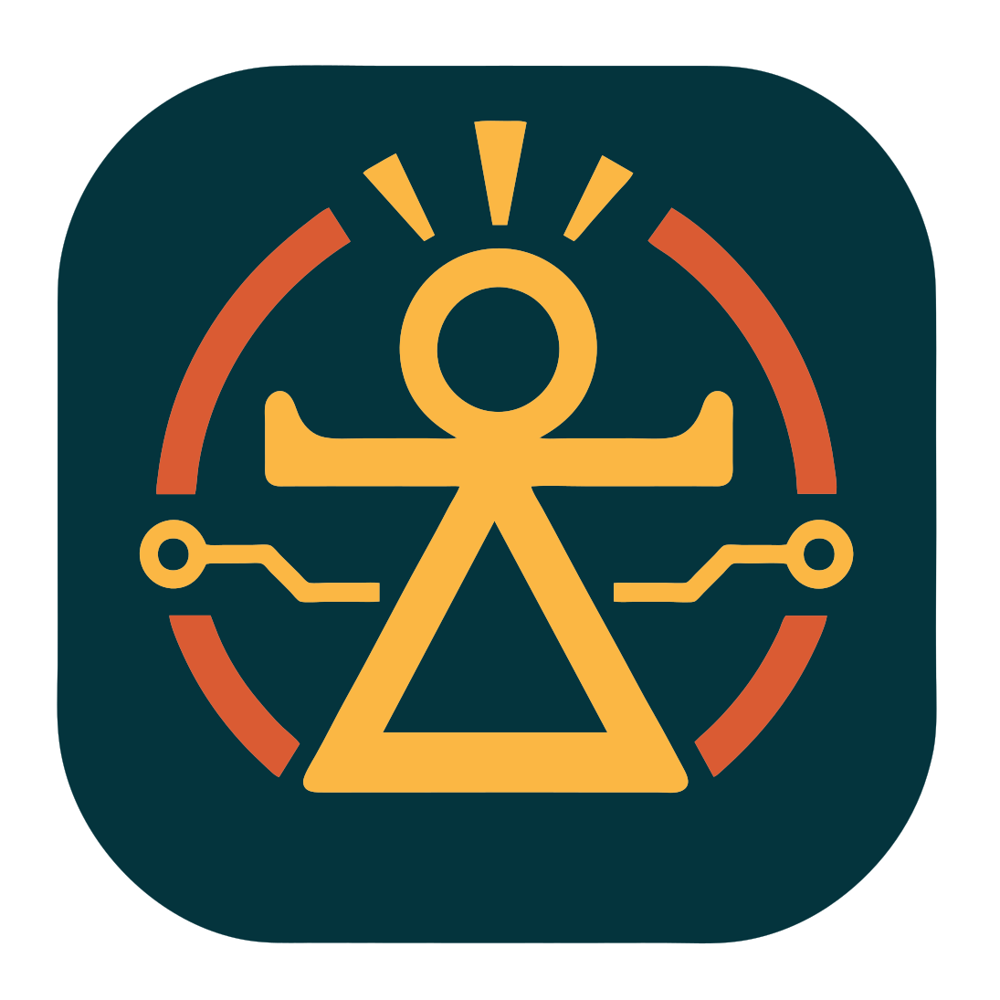

  

<h1 align="center">Mario Cabrero Volarich</h1>

  <strong>Full-stack TypeScript engineer building developer tooling, AI infrastructure and product software.</strong> 
  Angular · Vue · React · NestJS · Bun · Rust/Tauri · Godot · Docker

  
  
  
  

---

## Featured Projects

<table>
<tr>
<td width="33%" align="center" valign="top">
 
<strong>DelendAI</strong> 
Extensible MCP server core and CLI plugin tooling  
A project-agnostic core for building MCP servers and the plugin loader that feeds them. Lazy surface, public errors, private data — wrapped in a full proposal-to-release pipeline.
  
<a href="https://github.com/CartagoGit/DelendAI">Repository</a> ·
<a href="https://github.com/CartagoGit/DelendAI/releases">Releases</a>
</td>
<td width="33%" align="center" valign="top">
 
<strong>API Source Tanit</strong> 
Static API discovery from source code  
Points at a project directory and produces a ready-to-import API description. 25 frameworks detected from the code, exported to Postman, Bruno, Insomnia, HAR, OpenAPI or cURL.
  
<a href="https://github.com/CartagoGit/api-source-tanit">Repository</a> ·
<a href="https://github.com/CartagoGit/api-source-tanit/releases">Releases</a>
</td>
<td width="33%" align="center" valign="top">
 
<strong>QuickModel</strong> 
TypeScript model serialization library  
SOLID architecture, automatic type transformation, validation adapters, benchmarks and an MCP server on top. The test suite is larger than the source on purpose.
  
<a href="https://github.com/CartagoGit/quickmodel">Repository</a> ·
<a href="https://cartagogit.github.io/quickmodel/">Docs</a>
</td>
</tr>
<tr>
<td width="33%" align="center" valign="top">
 
<strong>Steam Keys</strong> 
Local-first desktop manager for game keys  
Tauri 2, Rust, React and SQLite. No accounts, no cloud, no telemetry — and the repository never contains a real key.
  
<a href="https://github.com/CartagoGit/steam-keys">Repository</a>
</td>
<td width="33%" align="center" valign="top">
 
<strong>Print CV</strong> 
A CV application you can print  
Vue 3 and TypeScript, with the curriculum modelled as validated data, internationalised in English and Spanish, and a print mode designed around real paper.
  
<a href="https://github.com/CartagoGit/print-cv">Repository</a> ·
<a href="https://cartagogit.github.io/print-cv/">Live app</a>
</td>
<td width="33%" align="center" valign="top">
 
<strong>Cartago</strong> 
Angular 22 zoneless SSR portfolio  
The live site behind this profile: zoneless, server-rendered, with unit and integration tests and an MCP server wired into the build.
  
<a href="https://github.com/CartagoGit/portfolio">Repository</a> ·
<a href="https://cartagogit.github.io">Live site</a>
</td>
</tr>
</table>

---

## What I work on

| Capability | What it means in practice | Where the evidence is |
| --- | --- | --- |
| **AI infrastructure & developer tooling** | An MCP runtime with a lazily-loaded plugin surface, hermetic execution, typed public errors, a CLI-first workflow and a proposal-driven release process. | [DelendAI](https://github.com/CartagoGit/DelendAI) · [QuickModel](https://github.com/CartagoGit/quickmodel) · [Keyer](https://github.com/CartagoGit/Keyer) |
| **Static analysis & developer experience** | Recovering an API from source code — no server, no annotations — across 25 frameworks, exported to the tools teams already use. | [API Source Tanit](https://github.com/CartagoGit/api-source-tanit) |
| **Product engineering** | Full-stack delivery with Angular (zoneless SSR), Vue and React on the front, NestJS and Bun on the back, with unit, integration and end-to-end coverage. | [Cartago](https://github.com/CartagoGit/portfolio) · [Print CV](https://github.com/CartagoGit/print-cv) · [NestGpt](https://github.com/CartagoGit/NestGpt) |
| **Desktop, game & content engineering** | Local-first desktop apps (Tauri 2 + Rust + SQLite), games in Godot/C#, and schema-validated content pipelines with localisation. | [Steam Keys](https://github.com/CartagoGit/steam-keys) · [Aoe2 mods](https://github.com/CartagoGit/aoe2-mods) · [Player Club Dynasty](https://github.com/CartagoGit/player-club-dynasty) |
| **Infrastructure & delivery** | Bun-first workspaces, reproducible Docker images, CI quality gates, and releases driven by machine-checked proposals. | [Docker images](https://hub.docker.com/u/cartagodocker) · [template-angular](https://github.com/CartagoGit/template-angular) |

---

## Evidence

Measured on the repositories linked above — source lines exclude tests, fixtures and generated files; test lines are the test suites themselves.

| Repository | Commits | Source lines | Test lines | Test files | Packages |
| --- | ---: | ---: | ---: | ---: | ---: |
| [DelendAI](https://github.com/CartagoGit/DelendAI) | 17,484 | 628,712 | 460,854 | 2,709 | 84 |
| [API Source Tanit](https://github.com/CartagoGit/api-source-tanit) | 1,876 | 99,398 | 73,489 | 362 | 53 |
| [QuickModel](https://github.com/CartagoGit/quickmodel) | 550 | 58,636 | 100,258 | 407 | 1 |
| [Player Club Dynasty](https://github.com/CartagoGit/player-club-dynasty) | 294 | 36,041 | 13,628 | 9 | 2 |
| [Steam Keys](https://github.com/CartagoGit/steam-keys) | 117 | 33,518 | 11,462 | 50 | 2 |
| [Aoe2 mods](https://github.com/CartagoGit/aoe2-mods) | 1,123 | 31,838 | 7,382 | 19 | 1 |
| [Cartago](https://github.com/CartagoGit/portfolio) | 162 | 6,352 | 1,047 | 21 | 2 |
| [Print CV](https://github.com/CartagoGit/print-cv) | 132 | 2,179 | 230 | 7 | 1 |

---

## How I work

- **Proposals before code.** Every non-trivial change starts as a written proposal with a goal, a design, slices, acceptance criteria and a risk section. Nothing lands without a machine-checkable acceptance test.
- **Tests as a ratchet.** Coverage thresholds only ever move upwards, and the script that enforces them fails the build when they slip.
- **Quality gates, not opinions.** Lint, typecheck, tests, generated-file drift, catalogue consistency and i18n parity run in CI — 18 workflows in the runtime core alone.
- **Documentation as code.** Architecture decisions are numbered and committed next to the code they explain; the runtime core carries more than 2,000 Markdown files.
- **AI-assisted delivery, human-owned decisions.** Work is routed through a proposal → implement → review → release pipeline where the agent proposes and the gates decide.
- **Bun first.** `bun` is the daily runtime for scripts, tests and workspaces; Node.js remains supported where production demands it.
- **Local-first and private by default.** Keys, databases and secrets stay on the machine, and repositories ship the `.gitignore` that guarantees it.

---

<strong>More projects</strong>

| Project | Focus | Link |
| --- | --- | --- |
| Secret manager CLI | Published npm package to encrypt keys, API keys and `.env` files. |  |
| NestJS AI API | Typed DTOs, file uploads, streaming and Docker-based delivery for AI-enabled apps. |  |
| React front-end | The client that talks to the NestJS AI API. |  |
| Zoneless Angular | Angular without zone.js, exercised by unit and integration tests. |  |
| Game content pipeline | Schema-validated campaign content for Age of Empires II, en + es-ES. |  |
| AI-assisted game delivery | A Godot/C# football manager built through a proposal → implement → review → release pipeline. |  |
| Workspace template | The Angular workspace every new app starts from. |  |
| Practice repositories | Daily puzzles and katas, one commit per solution. |   |

<strong>Core stack</strong>

**Languages & runtimes**

**Front-end**

**Back-end, data & tooling**

**Quality & delivery**

<strong>Docker images</strong>

Public development images for reproducible environments. Pull counts are live Docker Hub values.

| Image | Pulls | Link |
| --- | --- | --- |
| **nodebun** — Node.js + Bun + fnm |  |  |
| **zsh** — batteries-included shell |  |  |
| **ionic-cover** |  |  |
| **nestjs-cover** |  |  |
| **angular** |  |  |

## GitHub Activity

  

  

  

---

  Independent work, published in my own time. Professional and client work is not published here. 
  <a href="https://www.linkedin.com/in/mario-cabrero-volarich">LinkedIn</a> · <a href="https://cartagogit.github.io">Portfolio</a> · <a href="https://github.com/CartagoGit?tab=repositories">All repositories</a>

