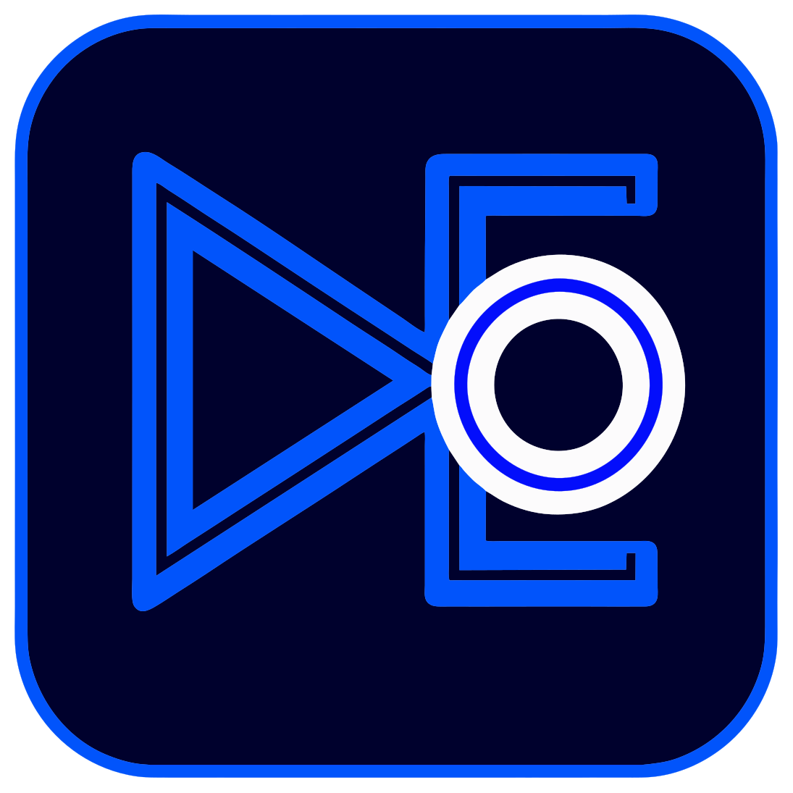
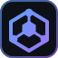
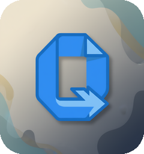

  

<h1 align="center">
   
  Mario Cabrero Volarich
</h1>

  <strong>Frontend engineer. Angular, Ionic and SCSS — plus the tooling and infrastructure to ship them.</strong> 
  Mentor · Technical decisions · Delivery · Angular · Ionic · Material · Sass · Bun · NestJS · Docker

  <a href="https://www.linkedin.com/in/mario-cabrero-volarich"><picture><source media="(prefers-color-scheme: light)" srcset="./assets/btn/light/linkedin.svg?v=3"></picture></a>
  <a href="https://www.npmjs.com/~cartago-git"><picture><source media="(prefers-color-scheme: light)" srcset="./assets/btn/light/npm-brand.svg?v=3"></picture></a>
  <a href="https://hub.docker.com/u/cartagodocker"><picture><source media="(prefers-color-scheme: light)" srcset="./assets/btn/light/docker.svg?v=3"></picture></a>
  <a href="https://cartagogit.github.io"><picture><source media="(prefers-color-scheme: light)" srcset="./assets/btn/light/portfolio.svg?v=3"></picture></a>

---

## What I build

**Front-end for operational systems.** ERP, warehouse logistics, workforce and attendance: the same
screens eight hours a day, with role-based permissions, complex validated forms and listings that
stay fast with years of data. My base is **Angular with SCSS**, **Ionic** when it needs to reach
Android, **Material** for the design system.

**Around the front-end.** Mentoring the team, deciding what stays in the front-end and what moves to
a service, deciding what gets a quality gate and what gets a written decision. GitLab CI,
GitHub Actions, Docker images with the versions pinned — the same environment on the laptop and
on the runner.

**Independent tooling.** Developer tools I needed and could not find: an MCP server with 62
capabilities, a static analysis engine for APIs, a serialization library, a secret manager. Each
one started from a concrete need in my own work.

Everything published here is **independent work** — repositories, libraries, images and
experiments built in my own time. My professional work is not published here.

---

## Featured Projects

<table>
<tr>
<td width="33%" align="center" valign="top">
 
<strong>DelendAI</strong> 
Extensible MCP server core and CLI plugin tooling  
An MCP server you point at a project: 62 isolated plugins, a CLI, nine presets and a proposal → implement → review → release cycle behind 18 CI gates. It knows nothing about your stack.
</td>
<td width="33%" align="center" valign="top">
 
<strong>API Source Tanit</strong> 
Static API discovery from source code  
Points at a project directory and produces a ready-to-import API description. 25 frameworks detected from the code, exported to Postman, Bruno, Insomnia, HAR, OpenAPI or cURL.
</td>
<td width="33%" align="center" valign="top">
 
<strong>QuickModel</strong> 
TypeScript model serialization library  
SOLID architecture, automatic type transformation, validation adapters, benchmarks and an MCP server on top. The test suite is larger than the source on purpose.
</td>
</tr>
<tr>
<td align="center" valign="top" width="33%">
<a href="https://github.com/CartagoGit/DelendAI"><picture><source media="(prefers-color-scheme: light)" srcset="./assets/btn/light/repo-delendai.svg?v=3"></picture></a>
<a href="https://github.com/CartagoGit/DelendAI/releases"><picture><source media="(prefers-color-scheme: light)" srcset="./assets/btn/light/releases.svg?v=3"></picture></a>
</td>
<td align="center" valign="top" width="33%">
<a href="https://github.com/CartagoGit/api-source-tanit"><picture><source media="(prefers-color-scheme: light)" srcset="./assets/btn/light/tanit.svg?v=3"></picture></a>
<a href="https://github.com/CartagoGit/api-source-tanit/releases"><picture><source media="(prefers-color-scheme: light)" srcset="./assets/btn/light/releases.svg?v=3"></picture></a>
</td>
<td align="center" valign="top" width="33%">
<a href="https://github.com/CartagoGit/quickmodel"><picture><source media="(prefers-color-scheme: light)" srcset="./assets/btn/light/repo-quickmodel.svg?v=3"></picture></a>
<a href="https://cartagogit.github.io/quickmodel/"><picture><source media="(prefers-color-scheme: light)" srcset="./assets/btn/light/docs.svg?v=3"></picture></a>
</td>
</tr>
<tr>
<td width="33%" align="center" valign="top">
 
<strong>Keyer</strong> 
Published npm CLI for secrets  
Encrypts keys, API keys and <code>.env</code> files from the command line. Published on npm and used to keep real credentials out of the repositories and the images.
</td>
<td width="33%" align="center" valign="top">
 
<strong>Print CV</strong> 
A CV application you can print  
Vue 3 and TypeScript, with the curriculum modelled as validated data, internationalised in English and Spanish, and a print mode designed around real paper.
</td>
<td width="33%" align="center" valign="top">
 
<strong>Cartago</strong> 
The site behind this profile  
An Angular application with server-side rendering, unit and integration tests and an MCP server wired into the build. Bilingual, it follows the system theme.
</td>
</tr>
<tr>
<td align="center" valign="top" width="33%">
<a href="https://github.com/CartagoGit/Keyer"><picture><source media="(prefers-color-scheme: light)" srcset="./assets/btn/light/repo-keyer.svg?v=3"></picture></a>
<a href="https://www.npmjs.com/package/@cartago-git/keyer"><picture><source media="(prefers-color-scheme: light)" srcset="./assets/btn/light/npm.svg?v=3"></picture></a>
</td>
<td align="center" valign="top" width="33%">
<a href="https://github.com/CartagoGit/print-cv"><picture><source media="(prefers-color-scheme: light)" srcset="./assets/btn/light/repo-print-cv.svg?v=3"></picture></a>
<a href="https://cartagogit.github.io/print-cv/"><picture><source media="(prefers-color-scheme: light)" srcset="./assets/btn/light/live.svg?v=3"></picture></a>
</td>
<td align="center" valign="top" width="33%">
<a href="https://github.com/CartagoGit/portfolio"><picture><source media="(prefers-color-scheme: light)" srcset="./assets/btn/light/repo-cartago.svg?v=3"></picture></a>
<a href="https://cartagogit.github.io"><picture><source media="(prefers-color-scheme: light)" srcset="./assets/btn/light/live.svg?v=3"></picture></a>
</td>
</tr>
</table>

---

## Professional experience

- **Operational front-end delivery.** Business applications for commercial, financial, inventory, logistics and workforce processes. Complex states, role-based permissions, reporting and business rules that must not break between releases.
- **Web and Android.** Angular and Ionic applications, packaged for Android with Capacitor, plus Vue and Quasar for the management panels and progressive web apps for what has to work without being installed. Interfaces designed for repeated, high-context use.
- **Mentoring and technical decisions.** I mentor the team, choose the architecture and settle the trade-offs: what stays in the front-end, what moves to a service, what gets a gate and what gets a document.
- **Delivery foundations.** Dockerised development environments, GitLab CI and GitHub Actions pipelines, container images, and focused test coverage on the parts that actually break.
- **AI-assisted, human-owned.** I use AI assistants for implementation; the architecture decisions, the code review and the acceptance criteria are mine.

## Beyond the front-end

- **Developer tooling.** An MCP server with 62 capabilities, a model serialization library and a static analysis engine, built because the tools I wanted did not exist.
- **Backend and runtime.** NestJS, Bun and Node for the services that sit behind the interfaces; SQLite and PostgreSQL for the data.
- **Games and content.** Local-first desktop apps in Tauri and Rust, games in Godot and C#, and schema-validated content pipelines with localisation.
- **Infrastructure.** Public Docker images for Angular, Ionic, NestJS, Node/Bun and Zsh, all with pinned version matrices.

---

## Evidence

**89 repositories** — 68 public and 21 private. **26** of them are active right now, and the
account has been publishing since October 2021.

Measured on the repositories linked above. Source lines exclude tests, fixtures and generated files; test lines are the test suites themselves.

| Repository | Commits | Source lines | Test lines | Tests over source |
| --- | ---: | ---: | ---: | ---: |
| <a href="https://github.com/CartagoGit/DelendAI"><picture><source media="(prefers-color-scheme: light)" srcset="./assets/btn/light/repo-delendai.svg?v=3"></picture></a> | 17,519 | 638,216 | 461,623 | 72% |
| <a href="https://github.com/CartagoGit/api-source-tanit"><picture><source media="(prefers-color-scheme: light)" srcset="./assets/btn/light/tanit.svg?v=3"></picture></a> | 1,924 | 91,960 | 78,219 | 85% |
| <a href="https://github.com/CartagoGit/quickmodel"><picture><source media="(prefers-color-scheme: light)" srcset="./assets/btn/light/repo-quickmodel.svg?v=3"></picture></a> | 550 | 48,641 | 103,771 | 213% |
| <a href="https://github.com/CartagoGit/player-club-dynasty"><picture><source media="(prefers-color-scheme: light)" srcset="./assets/btn/light/repo-pcd.svg?v=3"></picture></a> | 294 | 36,614 | 13,975 | 38% |
| <a href="https://github.com/CartagoGit/steam-keys"><picture><source media="(prefers-color-scheme: light)" srcset="./assets/btn/light/repo-steam-keys.svg?v=3"></picture></a> | 117 | 33,793 | 11,500 | 34% |
| <a href="https://github.com/CartagoGit/portfolio"><picture><source media="(prefers-color-scheme: light)" srcset="./assets/btn/light/repo-cartago.svg?v=3"></picture></a> | 164 | 11,870 | 1,047 | 9% |
| <a href="https://github.com/CartagoGit/print-cv"><picture><source media="(prefers-color-scheme: light)" srcset="./assets/btn/light/repo-print-cv.svg?v=3"></picture></a> | 133 | 2,849 | 230 | 8% |

DelendAI alone carries 62 first-party plugins, 18 CI workflows and more than 1,600 Markdown files of architecture decisions and guides.

---

## How I work

- **Proposals before code.** Every non-trivial change starts as a written proposal with a goal, a design, slices, acceptance criteria and a risk section. Nothing lands without a machine-checkable acceptance test.
- **Tests as a ratchet.** Coverage thresholds only ever move upwards, and the script that enforces them fails the build when they slip.
- **Quality gates, not opinions.** Lint, typecheck, tests, generated-file drift, catalogue consistency and i18n parity run in CI — 18 workflows in the runtime core alone.
- **Documentation as code.** Architecture decision records (ADRs) are numbered and committed next to the code they explain; the runtime core carries more than 2,000 Markdown files.
- **AI-assisted delivery, human-owned decisions.** Work is routed through a proposal → implement → review → release pipeline where the agent proposes and the gates decide.
- **Bun first.** `bun` is the daily runtime for scripts, tests and workspaces; Node.js remains supported where production demands it.
- **Local-first and private by default.** Keys, databases and secrets stay on the machine, and repositories ship the `.gitignore` that guarantees it.

---

<picture><source media="(prefers-color-scheme: light)" srcset="./assets/summary/light/more-projects.svg"></picture>
<picture><source media="(prefers-color-scheme: light)" srcset="./assets/summary/light/more-projects-open.svg"></picture>

| Project | Focus | Link |
| --- | --- | --- |
| NestJS AI API | Typed DTOs, file uploads, streaming and Docker-based delivery for AI-enabled apps. | <a href="https://github.com/CartagoGit/NestGpt"><picture><source media="(prefers-color-scheme: light)" srcset="./assets/btn/light/repo-nestgpt.svg?v=3"></picture></a> |
| React front-end | The client that talks to the NestJS AI API. | <a href="https://github.com/CartagoGit/ReactGpt"><picture><source media="(prefers-color-scheme: light)" srcset="./assets/btn/light/repo-reactgpt.svg?v=3"></picture></a> |
| Zoneless Angular | Angular without zone.js, exercised by unit and integration tests. | <a href="https://github.com/CartagoGit/zoneless-calculator"><picture><source media="(prefers-color-scheme: light)" srcset="./assets/btn/light/repo-zoneless.svg?v=3"></picture></a> |
| Modding and content | Tools and content for modifying games: binary formats, localisation and automation. | <a href="https://github.com/CartagoGit/aoe2-mods"><picture><source media="(prefers-color-scheme: light)" srcset="./assets/btn/light/repo-aoe2.svg?v=3"></picture></a> <a href="https://github.com/CartagoGit/pcfutbol6-mod"><picture><source media="(prefers-color-scheme: light)" srcset="./assets/btn/light/repo-pcfutbol.svg?v=3"></picture></a> |
| AI-assisted game delivery | A Godot/C# football manager built through a proposal → implement → review → release pipeline. | <a href="https://github.com/CartagoGit/player-club-dynasty"><picture><source media="(prefers-color-scheme: light)" srcset="./assets/btn/light/repo-pcd.svg?v=3"></picture></a> |
| Local-first desktop app | A Tauri 2 + Rust + SQLite manager that keeps game keys off the cloud. | <a href="https://github.com/CartagoGit/steam-keys"><picture><source media="(prefers-color-scheme: light)" srcset="./assets/btn/light/repo-steam-keys.svg?v=3"></picture></a> |
| Workspace template | The Angular workspace every new app starts from. | <a href="https://github.com/CartagoGit/template-angular"><picture><source media="(prefers-color-scheme: light)" srcset="./assets/btn/light/repo-template.svg?v=3"></picture></a> |
| Practice repositories | Daily puzzles and katas, one commit per solution. | <a href="https://github.com/CartagoGit/codember-dev"><picture><source media="(prefers-color-scheme: light)" srcset="./assets/btn/light/repo-codember.svg?v=3"></picture></a> <a href="https://github.com/CartagoGit/codewars"><picture><source media="(prefers-color-scheme: light)" srcset="./assets/btn/light/repo-codewars.svg?v=3"></picture></a> |

<picture><source media="(prefers-color-scheme: light)" srcset="./assets/summary/light/core-stack.svg"></picture>
<picture><source media="(prefers-color-scheme: light)" srcset="./assets/summary/light/core-stack-open.svg"></picture>

**Front-end — my base**

<picture><source media="(prefers-color-scheme: light)" srcset="./assets/btn/light/tech-angular.svg?v=3"></picture>
<picture><source media="(prefers-color-scheme: light)" srcset="./assets/btn/light/tech-ionic.svg?v=3"></picture>
<picture><source media="(prefers-color-scheme: light)" srcset="./assets/btn/light/tech-material.svg?v=3"></picture>
<picture><source media="(prefers-color-scheme: light)" srcset="./assets/btn/light/tech-sass.svg?v=3"></picture>
<picture><source media="(prefers-color-scheme: light)" srcset="./assets/btn/light/tech-typescript.svg?v=3"></picture>
<picture><source media="(prefers-color-scheme: light)" srcset="./assets/btn/light/tech-rxjs.svg?v=3"></picture>
<picture><source media="(prefers-color-scheme: light)" srcset="./assets/btn/light/tech-capacitor.svg?v=3"></picture>
<picture><source media="(prefers-color-scheme: light)" srcset="./assets/btn/light/tech-tailwind.svg?v=3"></picture>
<picture><source media="(prefers-color-scheme: light)" srcset="./assets/btn/light/tech-vue.svg?v=3"></picture>
<picture><source media="(prefers-color-scheme: light)" srcset="./assets/btn/light/tech-react.svg?v=3"></picture>

**Services, data & runtime**

<picture><source media="(prefers-color-scheme: light)" srcset="./assets/btn/light/tech-nestjs.svg?v=3"></picture>
<picture><source media="(prefers-color-scheme: light)" srcset="./assets/btn/light/tech-bun.svg?v=3"></picture>
<picture><source media="(prefers-color-scheme: light)" srcset="./assets/btn/light/tech-nodejs.svg?v=3"></picture>
<picture><source media="(prefers-color-scheme: light)" srcset="./assets/btn/light/tech-postgresql.svg?v=3"></picture>
<picture><source media="(prefers-color-scheme: light)" srcset="./assets/btn/light/tech-sqlite.svg?v=3"></picture>
<picture><source media="(prefers-color-scheme: light)" srcset="./assets/btn/light/tech-mongodb.svg?v=3"></picture>
<picture><source media="(prefers-color-scheme: light)" srcset="./assets/btn/light/tech-zod.svg?v=3"></picture>
<picture><source media="(prefers-color-scheme: light)" srcset="./assets/btn/light/tech-openapi.svg?v=3"></picture>

**Tooling & AI infrastructure**

<picture><source media="(prefers-color-scheme: light)" srcset="./assets/btn/light/tech-mcp.svg?v=3"></picture>
<picture><source media="(prefers-color-scheme: light)" srcset="./assets/btn/light/tech-tauri.svg?v=3"></picture>
<picture><source media="(prefers-color-scheme: light)" srcset="./assets/btn/light/tech-rust.svg?v=3"></picture>
<picture><source media="(prefers-color-scheme: light)" srcset="./assets/btn/light/tech-godot.svg?v=3"></picture>
<picture><source media="(prefers-color-scheme: light)" srcset="./assets/btn/light/tech-python.svg?v=3"></picture>
<picture><source media="(prefers-color-scheme: light)" srcset="./assets/btn/light/tech-storybook.svg?v=3"></picture>
<picture><source media="(prefers-color-scheme: light)" srcset="./assets/btn/light/tech-primeng.svg?v=3"></picture>

**Quality & delivery**

<picture><source media="(prefers-color-scheme: light)" srcset="./assets/btn/light/tech-vitest.svg?v=3"></picture>
<picture><source media="(prefers-color-scheme: light)" srcset="./assets/btn/light/tech-jest.svg?v=3"></picture>
<picture><source media="(prefers-color-scheme: light)" srcset="./assets/btn/light/tech-playwright.svg?v=3"></picture>
<picture><source media="(prefers-color-scheme: light)" srcset="./assets/btn/light/tech-eslint.svg?v=3"></picture>
<picture><source media="(prefers-color-scheme: light)" srcset="./assets/btn/light/tech-prettier.svg?v=3"></picture>
<picture><source media="(prefers-color-scheme: light)" srcset="./assets/btn/light/tech-docker.svg?v=3"></picture>
<picture><source media="(prefers-color-scheme: light)" srcset="./assets/btn/light/tech-gitlab.svg?v=3"></picture>
<picture><source media="(prefers-color-scheme: light)" srcset="./assets/btn/light/tech-actions.svg?v=3"></picture>
<picture><source media="(prefers-color-scheme: light)" srcset="./assets/btn/light/tech-linux.svg?v=3"></picture>

**With AI**

<picture><source media="(prefers-color-scheme: light)" srcset="./assets/btn/light/tech-claude.svg?v=3"></picture>
<picture><source media="(prefers-color-scheme: light)" srcset="./assets/btn/light/tech-codex.svg?v=3"></picture>
<picture><source media="(prefers-color-scheme: light)" srcset="./assets/btn/light/tech-minimax.svg?v=3"></picture>
<picture><source media="(prefers-color-scheme: light)" srcset="./assets/btn/light/tech-grok.svg?v=3"></picture>
<picture><source media="(prefers-color-scheme: light)" srcset="./assets/btn/light/tech-gemini.svg?v=3"></picture>
<picture><source media="(prefers-color-scheme: light)" srcset="./assets/btn/light/tech-qwen.svg?v=3"></picture>
<picture><source media="(prefers-color-scheme: light)" srcset="./assets/btn/light/tech-glm.svg?v=3"></picture>
<picture><source media="(prefers-color-scheme: light)" srcset="./assets/btn/light/tech-mimo.svg?v=3"></picture>
<picture><source media="(prefers-color-scheme: light)" srcset="./assets/btn/light/tech-mai.svg?v=3"></picture>

<picture><source media="(prefers-color-scheme: light)" srcset="./assets/summary/light/docker-images.svg"></picture>
<picture><source media="(prefers-color-scheme: light)" srcset="./assets/summary/light/docker-images-open.svg"></picture>

Public development images for reproducible environments. Pull counts are live Docker Hub values.

| Image | Pulls | Link |
| --- | --- | --- |
| **nodebun** — Node.js + Bun + fnm |  | <a href="https://hub.docker.com/r/cartagodocker/nodebun"><picture><source media="(prefers-color-scheme: light)" srcset="./assets/btn/light/img-nodebun.svg?v=3"></picture></a> |
| **zsh** — batteries-included shell |  | <a href="https://hub.docker.com/r/cartagodocker/zsh"><picture><source media="(prefers-color-scheme: light)" srcset="./assets/btn/light/img-zsh.svg?v=3"></picture></a> |
| **ionic-cover** |  | <a href="https://hub.docker.com/r/cartagodocker/ionic-cover"><picture><source media="(prefers-color-scheme: light)" srcset="./assets/btn/light/img-ionic.svg?v=3"></picture></a> |
| **nestjs-cover** |  | <a href="https://hub.docker.com/r/cartagodocker/nestjs-cover"><picture><source media="(prefers-color-scheme: light)" srcset="./assets/btn/light/img-nestjs.svg?v=3"></picture></a> |
| **angular** |  | <a href="https://hub.docker.com/r/cartagodocker/angular"><picture><source media="(prefers-color-scheme: light)" srcset="./assets/btn/light/img-angular.svg?v=3"></picture></a> |

  <a href="https://hub.docker.com/u/cartagodocker"><picture><source media="(prefers-color-scheme: light)" srcset="./assets/btn/light/docker.svg?v=3"></picture></a>

## GitHub Activity

  <picture>
    <source media="(prefers-color-scheme: light)" srcset="./assets/activity/streak-light.svg">
    
  </picture>

  <picture>
    <source media="(prefers-color-scheme: light)" srcset="./assets/activity/graph-light.svg">
    
  </picture>

  <picture>
    <source media="(prefers-color-scheme: light)" srcset="./assets/activity/stats-light.svg">
    
  </picture>
  <picture>
    <source media="(prefers-color-scheme: light)" srcset="./assets/activity/langs-light.svg">
    
  </picture>

---

  Independent work, published in my own time. Professional and client work is not published here.

  <a href="https://www.linkedin.com/in/mario-cabrero-volarich"><picture><source media="(prefers-color-scheme: light)" srcset="./assets/btn/light/linkedin.svg?v=3"></picture></a>
  <a href="https://cartagogit.github.io"><picture><source media="(prefers-color-scheme: light)" srcset="./assets/btn/light/portfolio.svg?v=3"></picture></a>
  <a href="https://github.com/CartagoGit?tab=repositories"><picture><source media="(prefers-color-scheme: light)" srcset="./assets/btn/light/github.svg?v=3"></picture></a>

